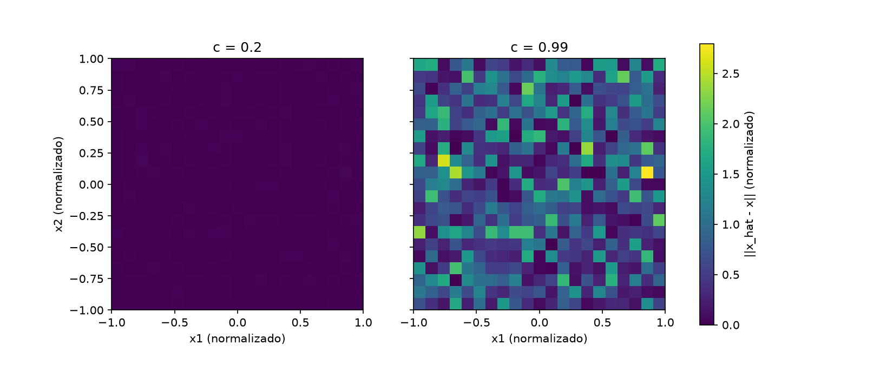

# Informe: Reconstrucción de señales y sensibilidad (Laboratorio 3)

Autora: Ximena Criollo

## 1. Modelo y decisiones

El modelo es `b = A(c) x + ε` con `A(c) = [[1, c], [c, 1]]`. Se comparan `c = 0.2` y `c = 0.99` con las mismas 441 señales (malla de 21 × 21 entre −1 y 1) y el mismo ruido normal (media 0, σ = 0.01, `default_rng(7)`).

- **Convención:** cada señal es una columna. `X` y `B` tienen forma (2, 441), `A` es (2, 2) y el ruido es (2, 441). Así `A @ X` produce todas las lecturas sin ciclos y `numpy.linalg.solve(A, B)` resuelve las 441 señales en una sola llamada.
- **Organización:** `modelo.py` (cálculo), `diagnostico.py` (verificación y estadísticas) y `experimento.py` (tablas y figura) están separados. Las pruebas están en `tests/`.
- **Contratos:** las funciones rechazan formas incompatibles y valores no finitos. `c = 1` se comunica como matriz singular (rango 1), mientras que `c = 0.99` no se trata como singular.
- **Tolerancias:** 1e-12 en las identidades matriciales (el redondeo observado es del orden de 1e-16) y 1e-10 al reconstruir sin ruido con `c = 0.99`.

**Predicción previa** (escrita antes de ejecutar el experimento): c = 0.99 sería más sensible al ruido porque los dos sensores miden casi lo mismo, y el residuo seguiría siendo pequeño en ambos casos.

## 2. Resultados

### Diagnóstico matricial

| c | autovalores | valores singulares | κ₂ | err Av=λv | err QᵀQ=I | err QR=A | err UΣVᵀ=A |
|---|---|---|---|---|---|---|---|
| 0.2 | [0.8, 1.2] | [1.2, 0.8] | 1.50 | 0.0e+00 | 4.4e-16 | 2.2e-16 | 2.5e-16 |
| 0.99 | [0.01, 1.99] | [1.99, 0.01] | 199.00 | 6.4e-17 | 4.4e-16 | 6.7e-16 | 7.8e-16 |

Las cuatro identidades se cumplen hasta el redondeo del computador (≈1e-16).

### Reconstrucción

| c | media del error (x1, x2) | desv. est. (x1, x2) | error euclidiano máx. | proporción > 0.1 | residuo máx. |
|---|---|---|---|---|---|
| 0.2 | [−0.00093, −0.00067] | [0.00987, 0.01023] | 0.0380 | 0.000 | 2.5e-16 |
| 0.99 | [−0.01075, 0.00979] | [0.66943, 0.66969] | 2.7945 | 0.902 | 5.0e-16 |

El umbral de 0.1 es un criterio didáctico fijo, no una tolerancia instrumental.

### Figura

Los dos paneles usan la misma escala de color. Con c = 0.2 el error es casi uniforme y pequeño. Con c = 0.99 aparece un mosaico de errores grandes: el error depende del ruido de cada señal, que es aleatorio, y no de su posición en la malla.

## 3. Discusión

**¿Qué diferencia hay entre `*` y `@`, y qué errores de forma podrían pasar inadvertidos?**
`@` es el producto matricial (cada lectura mezcla las dos componentes) y `*` multiplica elemento a elemento. Con 441 señales, `A * X` falla por forma, pero con una sola señal (`X` de forma (2, 1)) o con N = 2, `A * X` se ejecuta por broadcasting y da un resultado equivocado sin avisar. Algo parecido pasa si se organizan las señales en filas y N = 2: `A @ X` y `solve` funcionan, pero con otra interpretación. Por eso las funciones validan formas y hay pruebas de contrato.

**¿Qué aportan autovalores, QR y SVD, y por qué no basta con imprimirlos?**
Los autovalores de A son 1 + c (dirección [1, 1]) y 1 − c (dirección [1, −1]): indican qué combinación de señales se amplifica o se atenúa. QR da un factor Q ortogonal y uno triangular R. La SVD da los valores singulares, que son factores de amplificación, y de ahí κ₂ = σmáx/σmín (1.5 y 199). Imprimir las salidas no demuestra nada: hay que comprobar numéricamente `Av ≈ λv`, `QᵀQ ≈ I`, `QR ≈ A` y `UΣVᵀ ≈ A`, con tolerancia y sin depender de signos, porque distintas convenciones son válidas.

**¿Cómo se relaciona la dirección difícil con κ₂ y los errores? ¿Por qué κ₂ no predice cada error?**
La dirección difícil es [1, −1]/√2, con autovalor 1 − c: 0.8 para c = 0.2 y 0.01 para c = 0.99. Reconstruir exige dividir esa componente entre 0.01, así que amplifica el ruido unas 100 veces. Con ruido de σ = 0.01 se espera una desviación de unos 0.71 por componente (0.01·100/√2) y se observó 0.67. Para c = 0.2 se espera ≈ 0.011 y se observó ≈ 0.010. Pero κ₂ describe el peor caso de amplificación relativa. Cada error absoluto concreto depende de cuánto de ese ruido cae sobre la dirección difícil y del tamaño de la señal, por eso κ₂ no predice error por error.

**¿Por qué el residuo puede ser pequeño aunque la reconstrucción sea mala? ¿Qué cambia en c = 1?**
`solve` hace que `A x̂ ≈ b` se cumpla casi exactamente (residuo ≈ 1e-16 en ambos casos), pero `b` ya contiene el ruido: el error real es `x̂ − x = A⁻¹ε`, que puede ser grande cuando A⁻¹ amplifica. Con c = 0.99 el residuo fue 5.0e-16 y el error euclidiano máximo 2.79. En c = 1 las dos filas de A son iguales, el rango es 1 y σmín = 0: κ₂ es infinito, el sistema no tiene solución única y no se puede reconstruir. El código lo detecta y lo comunica, y las pruebas lo verifican sin simularlo como tercera configuración.

**¿Qué eje se reduce en cada estadística, cómo se usó broadcasting y cómo se protegió el arreglo original?**
Como cada señal es una columna, la media y la desviación por componente reducen el eje 1 (entre señales) y dan forma (2,). La norma euclidiana por señal reduce el eje 0 (entre componentes) y da forma (441,). Para centrar, `error - media[:, np.newaxis]` resta una columna (2, 1) a todo el arreglo (2, 441) por broadcasting (esa vista no copia datos), y la desviación se comprobó con ddof=0. Para proteger el original: `np.vstack` copia los datos de la malla, `A @ X + ruido` y `solve` crean arrays nuevos, y una prueba compara `X` y el ruido con copias hechas antes del procesamiento.

## 4. Limitaciones

- Una sola realización de ruido y una sola semilla: los números exactos cambian con otra semilla, aunque la diferencia entre c = 0.2 y c = 0.99 es de dos órdenes de magnitud.
- El umbral de 0.1 es didáctico y el análisis usa errores absolutos.
- Solo se comparan dos valores de c y no se estudian otros niveles de ruido.

## 5. Ejecución limpia

(Completar tras probar el README desde una copia nueva: comandos usados, versiones y resultado de `pytest`.)

## 6. Nota individual

(Predicción, una prueba explicada y una decisión de implementación, con tus palabras.)